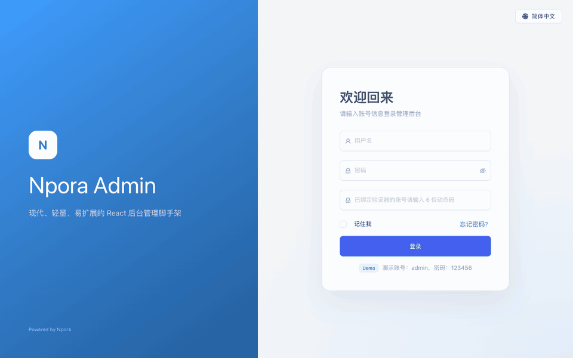

# Npora Admin · React

基于 React、TypeScript、Vite 和 Ant Design 的后台模板，请求使用 `@npora/request`。提供登录和会话、动态导航与菜单搜索、工作台、系统管理、个人中心和界面偏好。

React 与 Vue 模板目前覆盖相同的页面和功能。两者使用不同的前端技术栈，个别控件和交互细节采用各自组件库实现。当前模板版本与 Vue 模板、生成器统一为 1.0.26；本仓库是公开 GitHub 源码仓库，不单独发布 npm 包。

[](https://react.npora.live/)

[Npora 官网](https://www.npora.live/) · [React 在线演示](https://react.npora.live/) · [Vue 在线演示](https://admin.npora.live/) · [生成器](https://github.com/npora/create-admin)

GIF 使用隔离示例数据。React 线上演示使用独立的只读数据。演示账号和密码见登录页，登录与退出仍可正常体验。公开演示通过 [Npora Online](https://github.com/npora/online/tree/main/react) 构建和部署。

## 开始使用

需要 Node.js 22.12 或更新版本。

```sh
npm ci
npm run dev
```

开发服务器默认监听 `http://localhost:9000`，并将同源 `/api` 转发到 `.env.development` 中的后端。模板默认连接 `http://localhost:8080`，可修改 `.env.development` 中的 `VITE_API_URL` 接入其他后端。生产部署需要在同一域名下转发 `/api` 并将前端路由回退到 `index.html`。

页面以 Vue 的 `starter` 预设为参考。找回密码需要账号已绑定验证器。可通过 `VITE_PASSWORD_RESET_CONTACT` 显示管理员联系方式。

React 与 [Vue 模板](https://github.com/npora/admin-template) 共用后端接口。用户列表沿用 `system/user/index` 组件标识与 `system:user:list` 权限。当前仅在导航中展示已有 React 实现的页面。

```sh
npm run check:all
```

正式权限及字典模型见 [数据库初始化](database/README.md)和 [SQL 在线指南](https://react.npora.live/database/)，共享后端协议见 [接口契约](https://github.com/npora/admin-template/blob/main/docs/api.md)。模板只交付 React 前端、MySQL 初始化与迁移脚本及开发文档；在线演示、演示 API、隔离数据和 Cloudflare 部署由 [Npora Online](https://github.com/npora/online/tree/main/react) 管理。

可使用 [生成器](https://github.com/npora/create-admin)交互选择 Vue 或 React，或用 `--framework react` 直接创建 React 纯净项目。两种框架都由生成器支持。

## 源码目录

- `src/main.tsx` 是启动入口，`src/app/` 配置应用级 Provider。
- `src/router/` 管理路由入口、动态菜单和页面白名单。系统管理页面按 Vue 主模板的组件标识注册，例如 `system/user/index` 对应 `src/views/system/user/index.tsx`。
- `src/views/` 存放页面，`src/layout/` 存放后台框架，`src/components/` 存放跨页面组件。
- `src/api/`、`src/auth/` 分别维护接口请求、会话凭证和权限。中英文词条与公共 Sass 分别位于 `src/locales/` 和 `src/styles/`。

## 环境配置

- `VITE_API_PREFIX` 配置前端请求和开发代理共同使用的同源前缀，默认 `/api`。
- `VITE_TOKEN_STORAGE` 支持 `session`、`local` 和 `memory`。
- `VITE_AUTHENTICATOR_ENABLED` 控制验证器输入和状态的默认展示。
- `VITE_PASSWORD_RESET_CONTACT` 配置找回密码页的联系提示。

以下国际化变量可按项目需要显式覆盖。默认配置由应用提供。

- `VITE_I18N_ENABLED` 控制切换入口。关闭后固定使用默认语言。
- `VITE_I18N_DEFAULT_LOCALE` 和 `VITE_I18N_FALLBACK_LOCALE` 支持 `zh-CN`、`en-US`。
- `VITE_I18N_DETECT_BROWSER_LANGUAGE` 默认关闭，与 Vue 完整版一致。启用时，未手动选择语言的浏览器会按系统语言匹配。

## 构建产物

`npm run build` 使用 Vite 打包 React 应用。默认生成达到 10 KiB 且压缩后体积更小的静态资源的 `.gz` 副本，并保留原文件。设置 `VITE_BUILD_COMPRESS=false` 关闭预压缩。部署端需要按 `Accept-Encoding` 选择副本并返回相应的 `Content-Encoding`。

设置 `VITE_BUILD_ANALYZE=true` 可生成 `dist/bundle-report.json`，记录每个构建产物的原始、gzip、Brotli 字节数及 JS 分块的模块数量。

生产构建会生成 `sw.js` 用于检测新版本。检测到更新时，用户可以先保存编辑内容，再确认刷新。开发服务器不注册更新服务，更新服务不缓存业务接口。
